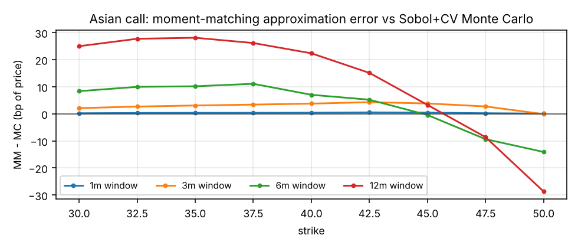
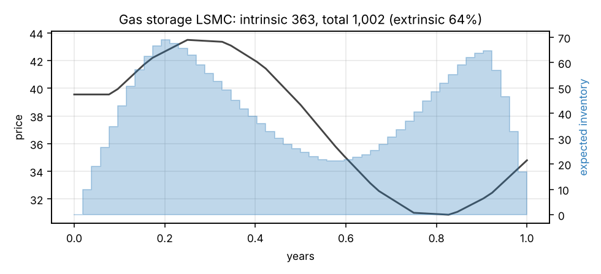
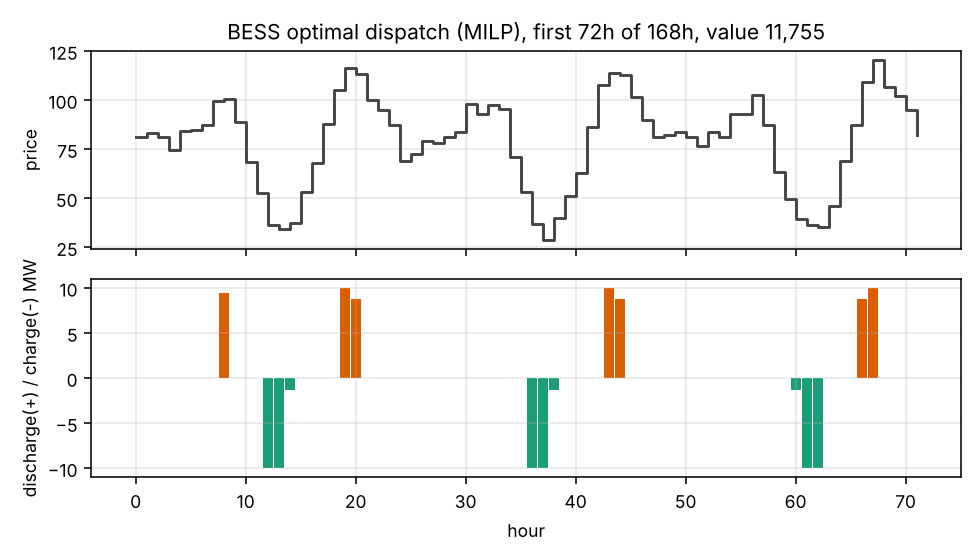

# enerq — energy derivatives pricing & risk in Python

[](https://github.com/peter88645/enerq/actions/workflows/ci.yml)


A small, production-style pricing library for the products an energy trading desk actually
books: options on forwards, monthly-average (Asian) options, gas storage and battery storage.
It is built the way front-office quant code should be: vectorised numerics, an extensible
pricing engine, bump-and-revalue risk in parallel, a typed API, and a test suite that checks
the *maths*, not just that functions run.

| Product | Model | Method |
|---|---|---|
| European option on forward | Black-76 | closed form, analytic Greeks, vectorised implied vol |
| Asian (average-price) option | one-factor lognormal | moment matching **and** Sobol QMC with geometric control variate |
| Gas storage | mean-reverting spot fitted to the forward curve | intrinsic DP + Longstaff–Schwartz LSMC (in- and out-of-sample) |
| Battery (BESS) | hourly price shape | mixed-integer programme (HiGHS), constraint value attribution |

```bash
pip install -e ".[dev,api]"
enerq price examples/portfolio.json --market examples/market.json --workers 4
enerq risk  examples/portfolio.json --market examples/market.json
enerq battery-attribution examples/portfolio.json --market examples/market.json
uvicorn enerq.api:app        # POST /price, POST /risk, GET /health
```

```python
import json, numpy as np
from enerq import AsianOption, EngineConfig, MarketData, price, risk_report

mkt = MarketData.from_dict(json.load(open("examples/market.json")))
dec = tuple(np.linspace(2 / 12, 3 / 12, 31))  # daily fixings in December
opt = AsianOption("DEC-AVG", strike=43, fixings=dec, notional=10_000)
price(opt, mkt, EngineConfig(asian_method="monte_carlo")).value
risk_report([opt], mkt)  # PV, delta, gamma, vega, bucketed delta ladder
```

## Design

```
src/enerq/
  market.py        immutable ForwardCurve / VolTermStructure / MarketData; bumps return new objects
  instruments.py   frozen, self-validating trade dataclasses with JSON round-trip
  engine.py        @register(Instrument) pricer registry, error-isolated pricing, process pool
  risk.py          central-difference Greeks, bucketed delta, scenario grids as one parallel batch
  models/          black76 · asian · storage · battery — pure functions on NumPy arrays
  cli.py · api.py  argparse CLI and FastAPI service (Pydantic only at the boundary)
```

Choices worth calling out:

- **Immutability for risk.** Market objects are frozen with read-only arrays. Every bump creates
  a new object, so revaluations can run in any order, on any process, with no shared state.
- **Open/closed engine.** Adding a product is one decorated function; the engine, CLI, API and
  risk code do not change.
- **One bad trade never kills a run.** Pricing errors are caught per trade and reported in the
  result table; risk refuses to compute Greeks from failed revaluations.
- **Common random numbers.** MC pricers use fixed seeds, so base and bumped valuations share
  random numbers and finite-difference Greeks are not swamped by simulation noise.
- **No Python loops over options or paths.** Black-76 and implied vol broadcast over arrays; the
  LSMC regression solves every inventory level with a single multi-RHS `lstsq`; the battery
  problem is assembled from sparse block matrices.
- **Typed throughout.** `mypy --strict` clean, `py.typed` shipped.

## Numerical notes

**Implied vol.** Safeguarded Newton inside a bisection bracket (price is monotone in vol, so
the bracket always holds the root). In-the-money options are inverted on the OTM side through
put–call parity, where the vol-dependent time value is not buried under intrinsic.

**Asian options.** Under the one-factor model `Cov(ln S_i, ln S_j) = w(min(t_i, t_j))`. Moment
matching fits a lognormal to the first two moments of the average; MC simulates the fixings
exactly and uses the geometric average, whose price is closed-form, as a control variate.
Already-fixed days reduce the effective strike, with the deep-ITM and fully-fixed cases handled
exactly. The MC is the benchmark that measures the closed form's approximation error:



**Gas storage.** Inventory lives on a grid; reachability of the final inventory is deterministic,
so infeasible states are pruned up front instead of being penalised inside the regression. The
policy is fitted on one set of paths and replayed on an independent set, giving a low-biased
estimate; the gap to the in-sample estimate measures policy (regression) error.



**Battery.** Charge, discharge, state of charge and a binary mode per hour; energy balance with
round-trip losses, SoC bounds, ramp limits, a cycling (throughput) limit and a terminal SoC.
`constraint_attribution` re-solves with each constraint relaxed to show what it costs.



## Benchmarks

`python benchmarks/run_benchmarks.py` (single core, x86_64, Python 3.13, NumPy 2.5):

| Benchmark | Time | Result |
|---|---:|---|
| Black-76 price, 1,000,000 options | 39 ms | vectorised NumPy |
| Black-76 price + 4 Greeks, 1,000,000 options | 89 ms | analytic |
| Implied vol, 1,000,000 options | 718 ms | max abs error vs true vol 1.5e-12 |
| Asian, moment matching (31 fixings) | 40 µs | 4.50943 |
| Asian MC 100k paths, pseudo-random | 36 ms | 4.49362 ± 2.1e-02 |
| Asian MC 100k paths, pseudo + geometric CV | 41 ms | 4.50857 ± 2.5e-04 |
| Asian MC 100k paths, Sobol + geometric CV | 53 ms | 4.50885 ± 8.0e-05 |
| Gas storage LSMC, 52 steps x 21 levels x 20k paths | 2.53 s | intrinsic 363.4, total 1001.7 ± 5.2 |
| BESS MILP, 168 h (672 vars, 168 binaries) | 32 ms | 11,755 |
| BESS MILP, 744 h (one month) | 0.21 s | 51,047 |

Sobol + control variate cuts the Asian MC standard error by ~260x for the same path count.

## Tests

`pytest` runs 51 tests, including Hypothesis property tests over hundreds of random inputs each:

- Black-76: put–call parity, no-arbitrage bounds, every Greek against finite differences,
  implied-vol round trip, degenerate inputs (zero vol / zero time).
- Asian: single fixing reduces to Black-76, averaging lowers value, MM vs MC agreement,
  control variate cuts error >10x, partially / fully fixed cases.
- Storage: hand-computed intrinsic, LSMC ≥ intrinsic, zero vol collapses to intrinsic, value
  rises with vol, in-sample and out-of-sample estimates agree.
- Battery: hourly energy balance, SoC / ramp / cycling / mode constraints hold in the solution,
  relaxing any constraint never lowers value, negative prices make the mode constraint bind.
- Engine & risk: JSON round-trip, error isolation, parallel == serial, bucketed deltas sum to
  parallel delta and land on the right pillars, finite-difference Greeks match analytic ones.
- API & CLI end-to-end.

CI runs ruff, `mypy --strict` and the test suite on Python 3.11–3.13.

## Limitations and next steps

- Single-factor dynamics: no seasonal vol, no smile, no multi-factor term-structure model.
- Storage vega is with respect to the spot model's vol, which the ladder does not bump.
- Battery valuation is intrinsic against a price shape; a stochastic (rolling-intrinsic or
  LSMC) extension would capture extrinsic value.
- Numba/JAX kernels for the LSMC forward pass would be the next performance step.

MIT licensed.
